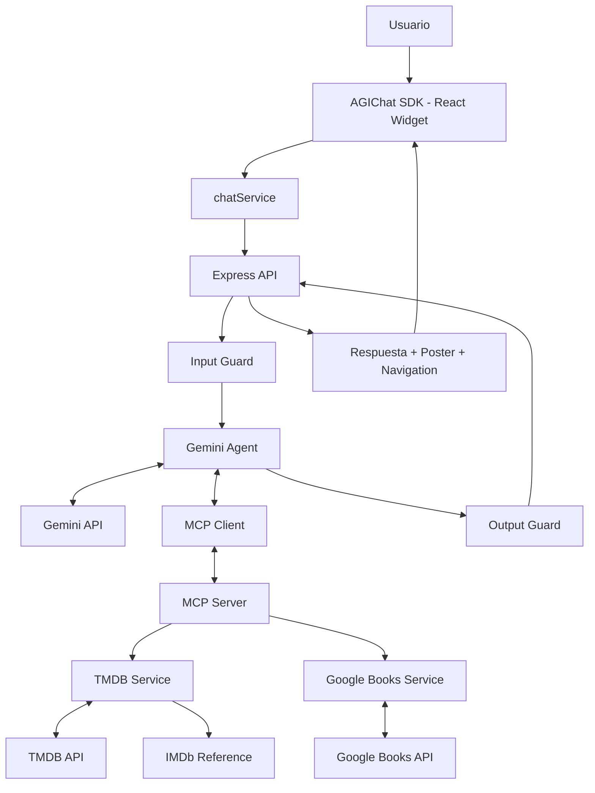
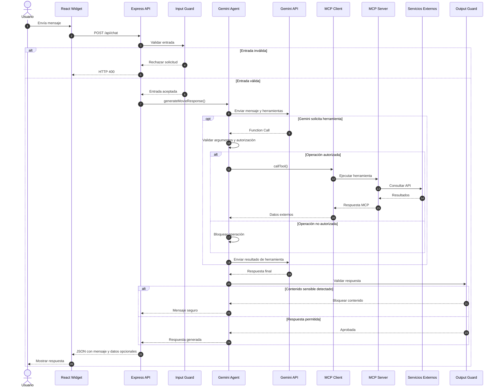

# AGIChat — Arquitectura Fase 2

## Descripción general

AGIChat es un SDK de chat desarrollado con React y TypeScript que integra un agente de inteligencia artificial basado en Gemini.

El agente utiliza herramientas MCP para consultar información de películas y libros mediante TMDB y Google Books.

El backend está desarrollado con Express y contiene controles de seguridad para validar entradas, autorizar determinadas operaciones y filtrar respuestas potencialmente sensibles.

## Componentes principales

| Componente | Responsabilidad |
|---|---|
| ChatWidget | Interfaz de conversación |
| chatService | Comunicación HTTP con Express |
| Express API | Procesamiento de solicitudes |
| inputGuard | Validación de mensajes |
| movieAgent | Orquestación de Gemini y MCP |
| MCP Client | Comunicación con herramientas |
| MCP Server | Registro y ejecución de herramientas |
| tmdbService | Consulta de películas y géneros |
| googleBooksService | Consulta de libros |
| outputGuard | Validación de respuestas |
| securityEvals | Evaluaciones LLM01 y LLM07 |

## Diagrama de arquitectura

## Herramientas MCP

- search_movies: búsqueda de películas por título.
- discover_movies: recomendaciones por género.
- search_books: búsqueda de libros.
- get_imdb_reference: obtención de referencias de IMDb.

## Seguridad

- LLM01: validación de autorización para llamadas a herramientas y comprobación de identificadores TMDB.
- LLM07: filtrado básico de respuestas potencialmente sensibles.
- Evals: pruebas automatizadas y evaluaciones reales contra Gemini.

Estas defensas reducen riesgos específicos, pero no garantizan protección completa frente a todos los ataques.

## Flujo de ejecución del agente

El siguiente diagrama representa cómo AGIChat procesa
una solicitud, consulta herramientas MCP y aplica
controles de seguridad.

### Controles de seguridad

**LLM01 - Prompt Injection**

El agente valida las llamadas a herramientas MCP.
Para consultar referencias de IMDb, verifica que
el usuario haya solicitado la apertura y que el
identificador corresponda a una búsqueda previa
de TMDB.

Los resultados de APIs externas se consideran
información no confiable.

**LLM07 - System Prompt Leakage**

Antes de devolver la respuesta final, el agente
utiliza outputGuard para detectar determinados
patrones de información sensible.

Si encuentra uno, sustituye la respuesta por
un mensaje seguro.

### Respuestas del backend

La API puede devolver:

- message: respuesta textual del agente.
- posterUrl: dirección del póster de TMDB.
- movieTitle: título de la película.
- navigation: referencia autorizada para abrir
  IMDb o Google Books.

Los campos adicionales son opcionales.

### Limitaciones

Los controles implementados reducen riesgos
específicos, pero no garantizan protección total
contra prompt injection ni filtraciones.

Las evaluaciones de seguridad documentan los
escenarios comprobados y sus resultados.
