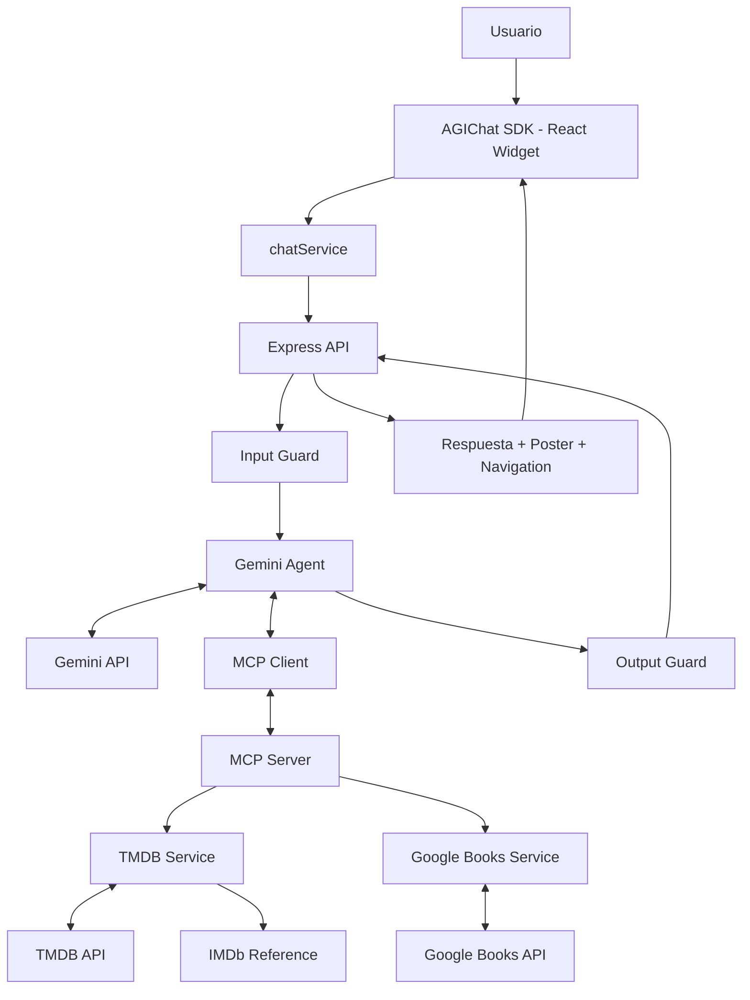
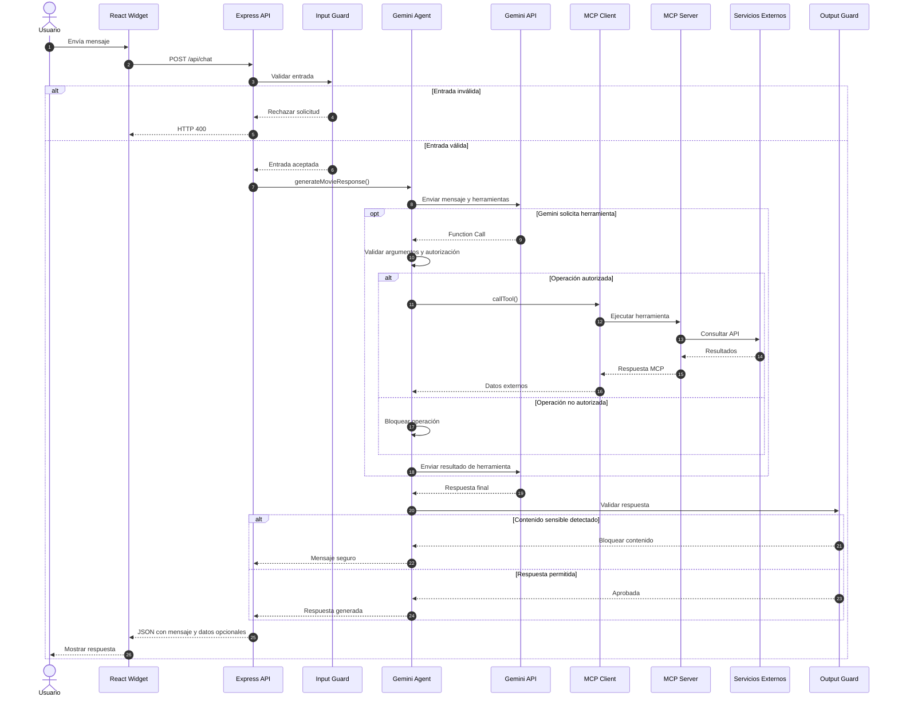
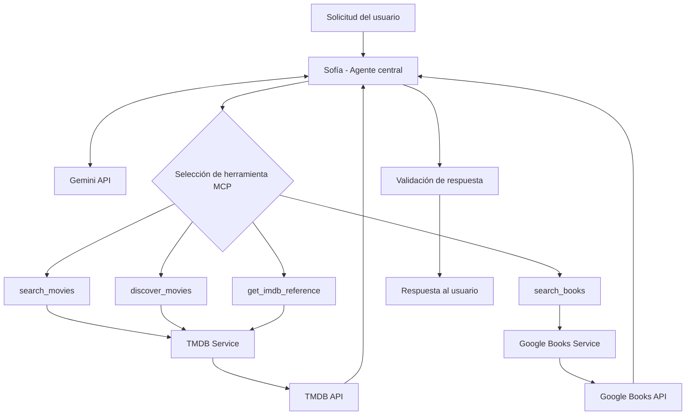

# AGIChat — Arquitectura Fase 2

## Descripción general

AGIChat es un SDK de chat desarrollado con React y TypeScript que integra un agente de inteligencia artificial basado en Gemini.

El agente utiliza herramientas MCP para consultar información de películas y libros mediante TMDB y Google Books.

El backend está desarrollado con Express y contiene controles de seguridad para validar entradas, autorizar determinadas operaciones y filtrar respuestas potencialmente sensibles.

## Componentes principales

| Componente | Responsabilidad |
|---|---|
| ChatWidget | Interfaz de conversación |
| chatService | Comunicación HTTP con Express |
| Express API | Procesamiento de solicitudes |
| inputGuard | Validación de mensajes |
| movieAgent | Orquestación de Gemini y MCP |
| MCP Client | Comunicación con herramientas |
| MCP Server | Registro y ejecución de herramientas |
| tmdbService | Consulta de películas y géneros |
| googleBooksService | Consulta de libros |
| outputGuard | Validación de respuestas |
| securityEvals | Evaluaciones LLM01 y LLM07 |

## Diagrama de arquitectura

## Herramientas MCP

- search_movies: búsqueda de películas por título.
- discover_movies: recomendaciones por género.
- search_books: búsqueda de libros.
- get_imdb_reference: obtención de referencias de IMDb.

## Seguridad

- LLM01: validación de autorización para llamadas a herramientas y comprobación de identificadores TMDB.
- LLM07: filtrado básico de respuestas potencialmente sensibles.
- Evals: pruebas automatizadas y evaluaciones reales contra Gemini.

Estas defensas reducen riesgos específicos, pero no garantizan protección completa frente a todos los ataques.

## Flujo de ejecución del agente

El siguiente diagrama representa cómo AGIChat procesa
una solicitud, consulta herramientas MCP y aplica
controles de seguridad.

### Controles de seguridad

**LLM01 - Prompt Injection**

El agente valida las llamadas a herramientas MCP.
Para consultar referencias de IMDb, verifica que
el usuario haya solicitado la apertura y que el
identificador corresponda a una búsqueda previa
de TMDB.

Los resultados de APIs externas se consideran
información no confiable.

**LLM07 - System Prompt Leakage**

Antes de devolver la respuesta final, el agente
utiliza outputGuard para detectar determinados
patrones de información sensible.

Si encuentra uno, sustituye la respuesta por
un mensaje seguro.

### Respuestas del backend

La API puede devolver:

- message: respuesta textual del agente.
- posterUrl: dirección del póster de TMDB.
- movieTitle: título de la película.
- navigation: referencia autorizada para abrir
  IMDb o Google Books.

Los campos adicionales son opcionales.

### Limitaciones

Los controles implementados reducen riesgos
específicos, pero no garantizan protección total
contra prompt injection ni filtraciones.

Las evaluaciones de seguridad documentan los
escenarios comprobados y sus resultados.

## Escalabilidad de la arquitectura

### Diseño modular

AGIChat utiliza una arquitectura modular que separa
la interfaz de usuario, el backend, la lógica del agente,
las herramientas MCP y los servicios externos.

Esta separación facilita el mantenimiento, la extensión
del sistema y su evolución hacia una infraestructura
capaz de atender una mayor cantidad de usuarios.

### Separación de responsabilidades

**Frontend — React SDK**

El widget de chat funciona como una interfaz
reutilizable que se comunica con el backend mediante
solicitudes HTTP.

Esto permite integrar AGIChat en diferentes
aplicaciones React sin modificar la lógica del agente.

**Backend — Express**

El backend recibe solicitudes, valida entradas,
coordina la ejecución del agente y devuelve respuestas.

La separación entre frontend y backend permite
evolucionar ambos componentes de manera independiente.

**Agente — Gemini**

Sofía centraliza la interpretación de solicitudes
y la selección de herramientas.

La lógica del agente está separada de las
implementaciones de TMDB y Google Books.

**Herramientas — MCP**

Las funcionalidades externas se abstraen mediante
un servidor MCP.

Actualmente proporciona cuatro herramientas:

- search_movies
- discover_movies
- search_books
- get_imdb_reference

Esta abstracción permite agregar nuevas herramientas
sin incorporarlas directamente al código del frontend.

**Servicios externos**

TMDB y Google Books se encuentran encapsulados
en servicios independientes.

Esto facilita modificar integraciones, incorporar
nuevos proveedores y mantener responsabilidades
separadas.

### Posibilidades de crecimiento

La arquitectura permite evolucionar en distintas
direcciones:

1. Incorporar nuevas herramientas MCP.
2. Integrar nuevas fuentes de información.
3. Reutilizar el SDK en diferentes aplicaciones.
4. Agregar agentes especializados en el futuro.
5. Introducir mecanismos de caché y control de cuotas.
6. Distribuir componentes del backend cuando
   la infraestructura lo requiera.

### Limitaciones actuales

AGIChat todavía no demuestra escalabilidad
horizontal mediante pruebas de carga.

Actualmente utiliza transportes MCP en memoria,
por lo que el cliente y el servidor MCP se
comunican dentro del proceso del backend.

Para distribuirlos entre servicios independientes
sería necesario implementar un transporte de red
compatible con MCP.

También deben considerarse:

- Los límites de solicitudes de TMDB y Google Books.
- La latencia y disponibilidad de Gemini.
- La cantidad de consultas MCP por solicitud.
- El consumo de recursos del backend.
- La ausencia de pruebas de carga documentadas.

### Conclusión

AGIChat presenta una arquitectura modular y
extensible que facilita su crecimiento.

Su diseño permite incorporar nuevas capacidades
sin reescribir completamente el sistema.

Sin embargo, la capacidad de atender grandes
volúmenes de usuarios simultáneos deberá
demostrarse mediante pruebas de rendimiento
y mejoras de infraestructura.

## Organización y clasificación del agente

### Tipo de arquitectura

AGIChat implementa una arquitectura centralizada
de agente único.

El agente Sofía, basado en Gemini, interpreta
las solicitudes del usuario y determina qué
herramientas MCP necesita utilizar.

No se implementa un sistema multiagente (MAS),
por lo que no existe una jerarquía ni coordinación
entre múltiples agentes.

### Diagrama de organización interna

Este diagrama representa las responsabilidades
lógicas del agente y sus herramientas, no una
implementación de múltiples agentes independientes.

### Justificación de la clasificación

Se considera una arquitectura centralizada porque
Sofía concentra las decisiones de selección
y coordinación de herramientas.

Las herramientas MCP no actúan como agentes
autónomos: ejecutan operaciones específicas
cuando son invocadas.

Este diseño es adecuado para el alcance actual
porque simplifica la coordinación, las pruebas
y el control de operaciones autorizadas.

En el futuro podrían incorporarse agentes
especializados, pero actualmente no son necesarios
para satisfacer los requisitos funcionales.
